<div align="center">


# Nimboo

**Um pequeno companheiro para o seu dia a dia.**

Um mascote expressivo que vive na área de trabalho do Windows e, sem atrapalhar, ajuda com
tarefas, foco, notas, agenda e música.

`Windows 10/11` · `Electron 44` · `React 19` · `TypeScript` · `SQLite local` · `100% offline por padrão`

**[⬇ Baixar o instalador (Windows)](https://github.com/Eterno12/Nimboo-Buddy/releases/latest)**

</div>

> O instalador não tem assinatura digital: se o Windows mostrar "O Windows protegeu o computador",
> clique em **Mais informações → Executar assim mesmo**. Não precisa de administrador.

---

## O que é

O Nimboo junta duas ideias que costumam viver separadas: **um bichinho virtual** (que olha para o seu
cursor, ri quando você faz cócegas, cochila quando você some e comemora quando você termina algo) e
**um assistente discreto**, que fica recolhido numa "ilha" no topo da tela e só aparece quando você
precisa.

Tudo fica no seu computador. A internet só é usada se você ligar, uma por uma, as opções que precisam
dela (Google Agenda, Wikipédia e Gemini).

<div align="center">
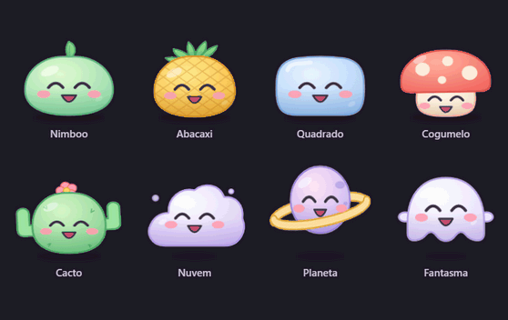

*Oito personagens com o mesmo rosto e as mesmas reações, mas corpo, ritmo e "voz" próprios.*
</div>

## Destaques

<table>
<tr>
<td width="33%" align="center">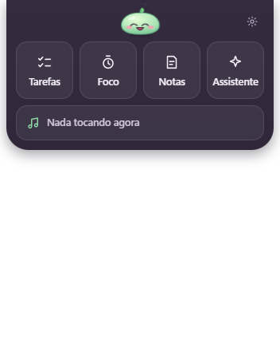<br><b>A ilha</b><br>Recolhida no topo da tela; abre com um clique ou atalho.</td>
<td width="33%" align="center">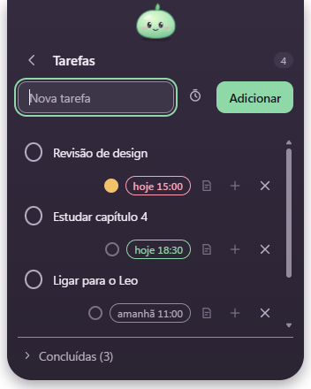<br><b>Tarefas</b><br>Prazos, prioridade, subtarefas, repetição e lembretes.</td>
<td width="33%" align="center">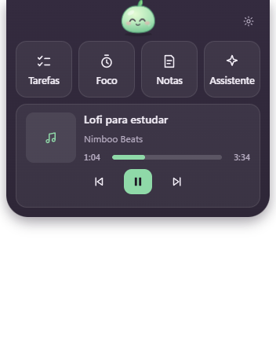<br><b>Música</b><br>Mostra e controla o que toca no Windows. O Nimboo dança junto.</td>
</tr>
<tr>
<td align="center">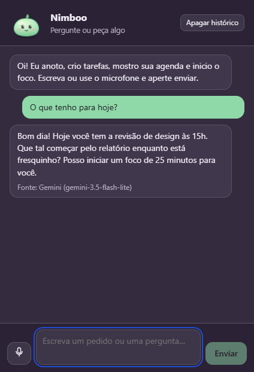<br><b>Assistente</b><br>Comandos locais e, se você quiser, conversa com o Gemini.</td>
<td align="center">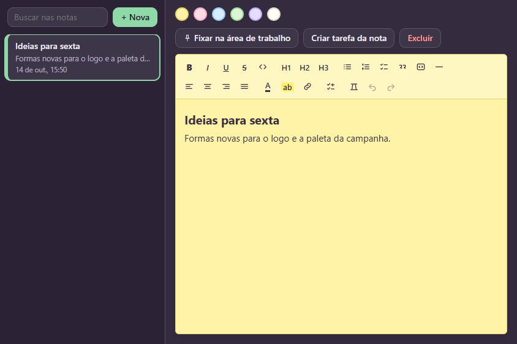<br><b>Notas</b><br>Editor rico; fixe uma nota na área de trabalho.</td>
<td align="center">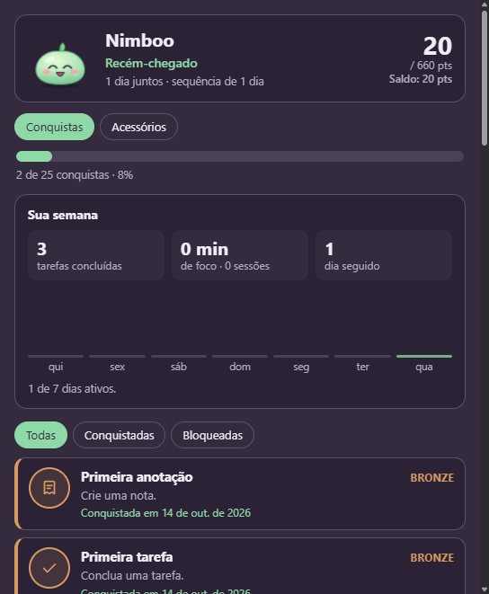<br><b>Conquistas</b><br>Troféus no estilo Steam/PSN e o resumo da semana.</td>
</tr>
</table>

### Tudo o que ele faz

| Área | O que tem |
|---|---|
| **Mascote** | Segue o cursor com os olhos, 12 estados (curioso, susto, cócegas, emburrado, sono, espreguiçar...), humor que persiste, arrastar e soltar com física |
| **Ilha** | Entra e sai sozinha, recolhe por inatividade, não aparece por cima de jogos e vídeos em tela cheia |
| **Tarefas** | Edição, prioridade, subtarefas, repetição, adiar, ordem manual, prazos com lembrete e aviso com **Concluir / Adiar** |
| **Foco** | Pomodoro (15–60 min ou livre), tarefa vinculada, estatísticas do dia e da semana |
| **Agenda** | Até 5 agendas iCal (Google Agenda), "Agenda de hoje", evento vira tarefa |
| **Notas** | Editor rico (Tiptap), cores de papel, notas fixadas na área de trabalho |
| **Assistente** | Comandos em português ("me lembre de...", "o que tenho amanhã?"), microfone, histórico local apagável, Gemini opcional com cartões de ação |
| **Música** | Lê o que toca no Windows (Spotify, navegador, VLC...) e controla tocar/pausar/próxima |
| **Vínculo** | Dias juntos, sequência, 25 conquistas com avisos e uma **loja de acessórios** paga com pontos |
| **Bem-estar** | Lembretes gentis de água, postura e descanso dos olhos (desligados por padrão) |
| **Rotina** | Resumo da manhã e fechamento do dia |

O manual completo, com todos os comandos e opções, está no **[Guia de uso](docs/GUIA.md)**.

## Personagens e acessórios

<div align="center">
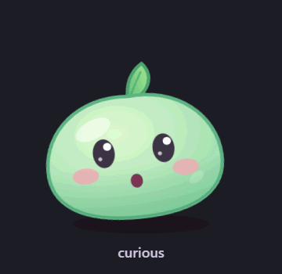
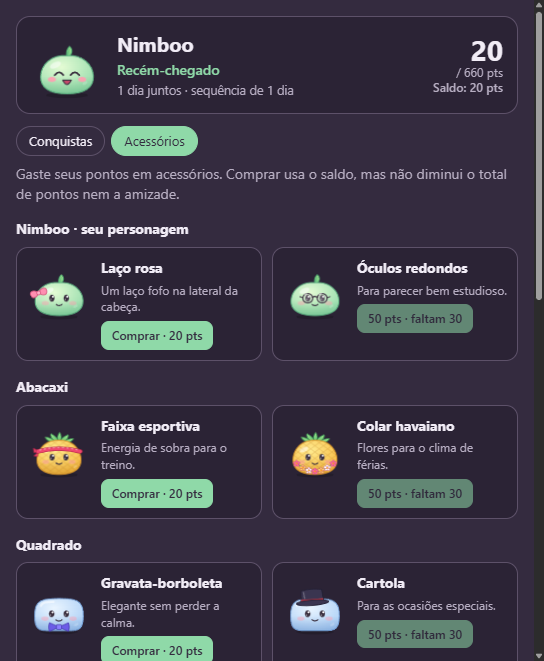
</div>

Cada personagem tem dois acessórios exclusivos. Eles são comprados com os pontos das conquistas
(comprar gasta o saldo, mas não reduz o total nem a amizade) e só um fica em uso por vez.

<div align="center">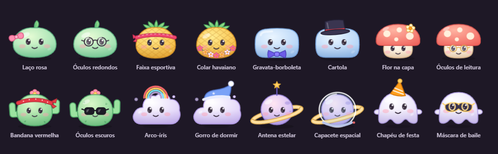</div>

## Nimboo no Android

O app do celular tem tarefas, foco, notas, conquistas, sons, lembretes, um **widget** com o mascote e a
**sincronização** com o PC (opcional, por conta). Baixe o APK na página de
[Releases](https://github.com/Eterno12/Nimboo-Buddy/releases) (repositório privado: entre com a conta do GitHub).

**Instalar:** abra o APK no celular e permita "instalar de fontes desconhecidas" quando o Android pedir.

**Conectar ao PC sem e-mail:** no PC, Configurações → Conta e sincronização → *Conectar o celular com QR code*; no
celular, Perfil → *Escanear QR do PC*. Detalhes e comandos de build em [docs/MOBILE.md](docs/MOBILE.md).

## Primeira execução e configurações

<table>
<tr>
<td width="50%" align="center">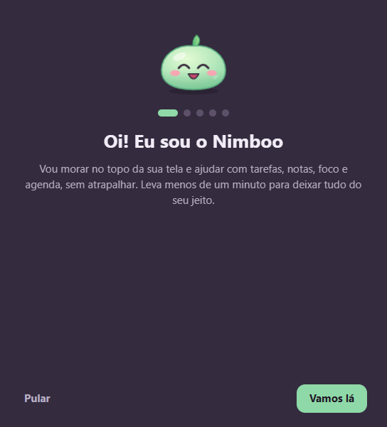<br>Introdução guiada: personagem, nome, rotina e música.</td>
<td width="50%" align="center">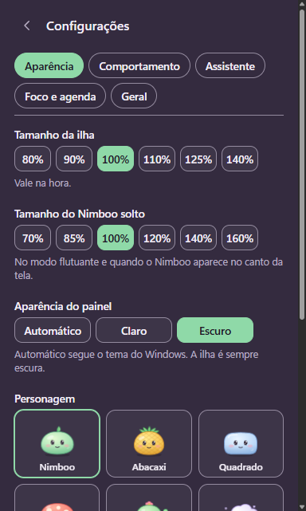<br>Configurações em abas, com prévia dos personagens.</td>
</tr>
</table>

## Filme de lançamento

Uma peça de motion design de **30 segundos** feita só com HTML, CSS e GSAP, com trilha e efeitos
sonoros sintetizados no navegador (Web Audio). Fica em [`launch/`](launch/).

<table>
<tr>
<td width="50%">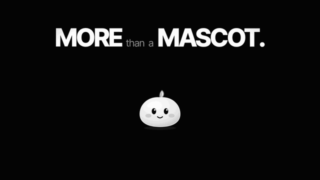</td>
<td width="50%">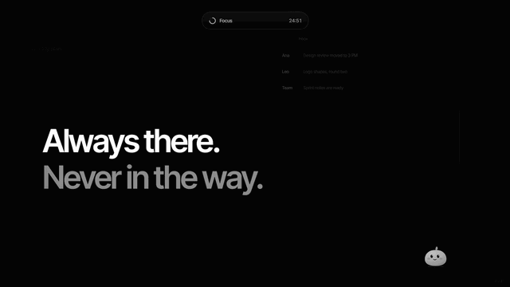</td>
</tr>
<tr>
<td colspan="2" align="center"></td>
</tr>
</table>

Para assistir:

```bash
node node_modules/vite/bin/vite.js --port 5199
```

Abra `http://localhost:5199/launch/index.html` e clique uma vez no filme para ligar o som.
Atalhos: **Espaço** pausa, **R** recomeça, **C** modo apresentação, **M** som, **1–7** pula de cena.

## Como rodar

**Requisitos:** Windows 10/11, Node.js 22 LTS ou superior.

```bash
npm install
npm run dev      # desenvolvimento, com recarga
npm start        # compila e abre
npm run dist     # gera o instalador em release/
```

> Se o npm bloquear scripts de instalação, rode `node node_modules/electron/install.js` uma vez.

### Testes

```bash
npm test                 # 380+ testes unitários (runner nativo do Node)
npm run typecheck
npm run test:e2e         # interface no app real (precisa de sessão gráfica)
```

Os testes de ponta a ponta (18 suítes em [`tests/e2e/`](tests/e2e/)) abrem o app de verdade com uma
pasta de dados temporária e o controlam pelo protocolo de depuração do Chromium: nada toca nos seus dados.

## Como é feito

```
electron/   processo principal: janelas, bandeja, SQLite, agenda, Gemini, mídia, conquistas, logs
shared/     regras puras e tipos compartilhados (testáveis sem Electron)
src/        interface React: mascote, ilha, tarefas, foco, notas, assistente, conquistas...
tests/      testes unitários e e2e
launch/     filme de lançamento (GSAP + Web Audio)
docs/       arquitetura, decisões, plano, guia e imagens
```

- **Uma só build, várias janelas:** o hash da URL escolhe a tela (`#mascot`, `#panel`, `#assistant`,
  `#achievements`, `#notes`...).
- **Segurança:** `contextIsolation`, sem `nodeIntegration`, IPC tipado e validado no processo principal,
  navegação travada, segredos (chave do Gemini, endereços de agenda) cifrados pelo cofre do Windows.
- **Dados:** SQLite local com migrações versionadas e backup antes de migrar.
- **Mascote:** 100% SVG + CSS, com camadas de movimento separadas (respiração, salto, postura, olhar),
  para animações sobrepostas sem conflito.

Mais detalhes em [`docs/ARCHITECTURE.md`](docs/ARCHITECTURE.md) e as decisões (com motivos e limites)
em [`docs/DECISIONS.md`](docs/DECISIONS.md).

## Privacidade

- Tarefas, notas, conquistas e histórico ficam em `%APPDATA%\Nimboo`, só neste computador.
- Nada vai para a internet a menos que você ligue: Google Agenda, Wikipédia ou Gemini (este pede
  consentimento explícito e sua própria chave).
- Há um registro local de erros (`logs/nimboo.log`) que nunca é enviado.

## Documentação

| Documento | Conteúdo |
|---|---|
| [`docs/GUIA.md`](docs/GUIA.md) | Manual de uso completo |
| [`docs/ARCHITECTURE.md`](docs/ARCHITECTURE.md) | Módulos, fluxos, IPC, SQLite |
| [`docs/DECISIONS.md`](docs/DECISIONS.md) | Decisões técnicas, motivos e limitações |
| [`docs/PLANO.md`](docs/PLANO.md) | Etapas do projeto e o que falta |
| [`docs/PROJECT_STATUS.md`](docs/PROJECT_STATUS.md) | Estado atual e testes |
| [`CLAUDE.md`](CLAUDE.md) | Instruções para quem desenvolve com o Claude Code |

---

<div align="center">

Projeto pessoal, todos os direitos reservados.

</div>
